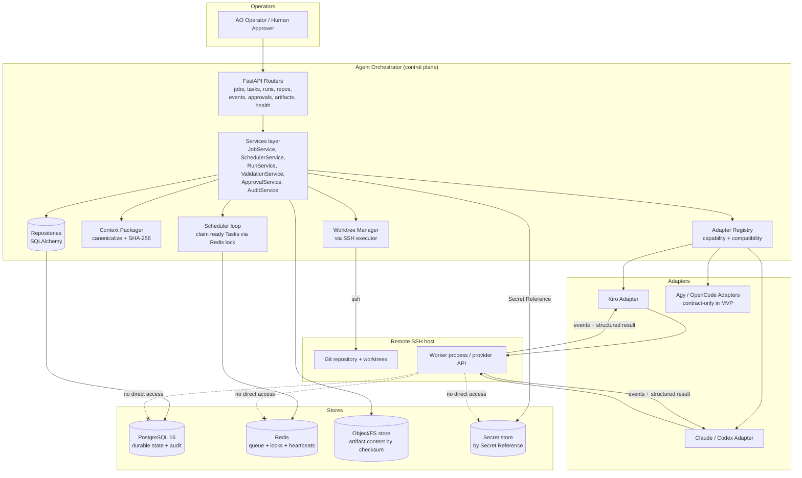
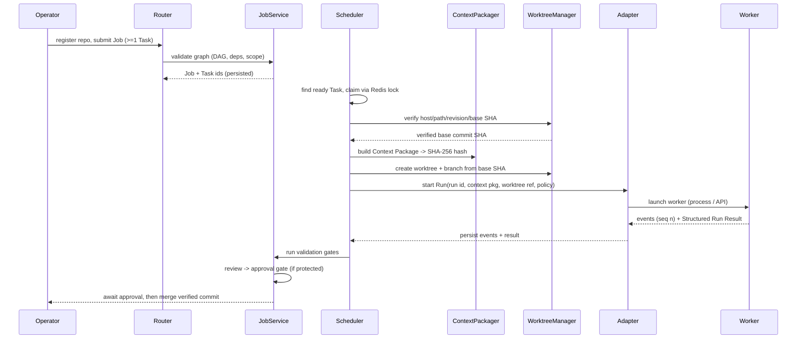
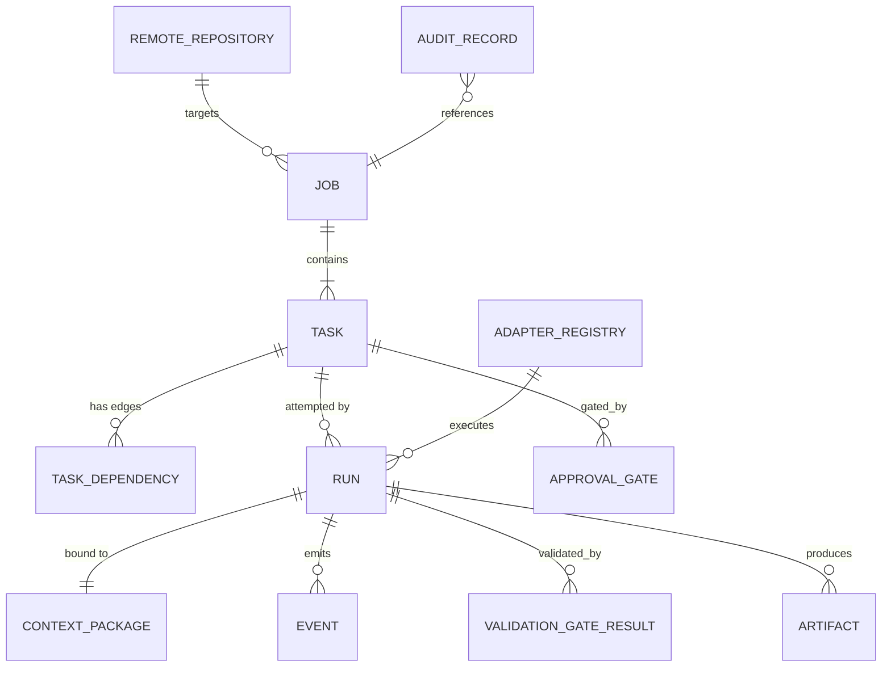

# Design Document

## Overview

The Agent Orchestrator (AO) is a control-plane service that coordinates heterogeneous coding agents (Kiro, Claude, Codex, Agy, OpenCode) against a Git repository that may live only on a remote SSH server. AO owns all orchestration state and policy. Workers (provider processes or APIs) are replaceable executors that never touch AO's data stores directly; they interact only through provider-specific Adapters that expose a single AO-defined contract.

This design covers the first implementation slice (the MVP) defined in Requirement 16: an AO skeleton with PostgreSQL durable state, Redis queue/lock support, Git worktree isolation, sequential execution, mandatory validation gates, audit records, and two working Adapters (Kiro plus one of Claude/Codex), while keeping the Adapter Registry contract extensible to Agy and OpenCode.

### Design Principles

- **AO owns state and policy.** Worker output is policy *input*, never an authoritative state mutation. Every lifecycle transition is decided by AO (Req 1.3, 1.4).
- **Immutable, hashed context.** Each Run is bound to a canonical, SHA-256-hashed Context Package and a verified base commit SHA; neither can change after Run start (Req 4).
- **Isolation by construction.** Each Run gets exactly one dedicated Git worktree and branch from the recorded base SHA (Req 8).
- **Structured evidence over prose.** Validation and merge decisions require structured results and gate evidence; free-form Worker output is retained only as bounded, redacted diagnostics (Req 7.6).
- **Least privilege and redaction by default.** Deny commands/paths/egress unless explicitly allowed; redact secrets and PII everywhere (Req 13).
- **Owner decisions are configuration or typed stubs.** `[NEEDS-OWNER]` items are never invented; they are exposed as typed config or `NotImplementedError` stubs (Req 16.7).

### Alignment with Workspace Conventions

Per `AGENTS.md`, AO is a Python 3.12 / FastAPI (async) service under `services/agent-orchestrator/`, using SQLAlchemy 2.x typed models, Alembic migrations, Pydantic v2 schemas (separate from ORM), PostgreSQL 16, Redis, `uv`, `pytest` + `pytest-asyncio`, and `ruff`. It follows the strict `router -> service -> repository` layering with typed domain exceptions mapped by a single FastAPI exception handler. Kafka is explicitly out of MVP scope; the synchronous PostgreSQL + Redis path is used (Req 15.6, 15.7). AO is a *separate* control plane from the DriverManagementPlatform business domain and does not implement any driver/booking/payroll business rules.

### MVP Boundary (Req 16.6)

Explicitly excluded from this slice: Kafka/event bus, local visibility of the source repository, direct Worker access to AO data stores, autonomous protected-branch merge, and autonomous production deployment. Parallel execution is modeled but limited to one running Task per Job (Req 3.8).

## Architecture

### Component Topology



### Layering

Following the workspace convention, every request flows `router -> service -> repository`:

- **Routers** (`app/routers/`) validate Pydantic input, call a service, and map typed domain exceptions to HTTP via a single exception handler. Routers never touch the DB or Redis directly.
- **Services** (`app/services/`) hold all orchestration policy and lifecycle rules. This is the only layer that decides transitions.
- **Repositories** (`app/services/<domain>/repository.py` or `app/core/repositories.py`) perform SQLAlchemy access and return ORM/domain objects.
- **Core** (`app/core/`) holds config, DB session, Redis client, SSH executor, security/redaction utilities, the policy engine, and the typed exception hierarchy.
- **Schemas** (`app/schemas/`) hold Pydantic v2 request/response and Context Package models, kept separate from ORM models.
- **Tools** (`app/tools/`) hold the Context Packager, Worktree Manager, and canonicalization/hashing helpers.
- **Workflows** (`app/workflows/`) hold the scheduler loop and lifecycle state-machine definitions.

### Execution Flow (happy path, Req 16.1)



### Durability, Queueing, and Locking (Req 15)

- **PostgreSQL** is the authoritative store for Job, Task, Run, Event, Artifact metadata, Approval Gate, Adapter Registry, Remote Repository, and audit records.
- **Redis** provides the ready-Task queue, per-Task/per-Run distributed locks (single active claim, Req 15.2/15.4), and Worker heartbeat tracking. Locks use a lease with a configurable TTL (`[NEEDS-OWNER]` lease duration, Req 15.8).
- **Atomic transition + audit**: each accepted state transition and its audit record are committed in a single PostgreSQL transaction. If atomicity cannot be guaranteed, the transition is marked `uncertain` and downstream protected actions are blocked until reconciliation (Req 15.5).
- **Restart recovery**: on startup, AO loads queued/active records from PostgreSQL and reconciles active Runs within the configured recovery window before starting any duplicate Run (Req 15.3, NFR-2).

## Components and Interfaces

All interfaces below are described as typed Python contracts (Protocol/ABC) and Pydantic schemas. Provider-specific details that the owner must confirm are typed configuration or `NotImplementedError` stubs, never invented behavior.

### 1. Adapter Contract and Registry (Req 5, 6)

The Adapter is the single boundary between AO and any provider. AO orchestration logic depends only on this contract.

```python
class AdapterCapability(StrEnum):
    START_RUN = "start_run"
    STREAM_EVENTS = "stream_events"
    CANCEL_RUN = "cancel_run"
    COLLECT_RESULT = "collect_result"
    REPORT_HEALTH = "report_health"

class Adapter(Protocol):
    provider: ProviderIdentity          # Kiro | Claude | Codex | Agy | OpenCode
    adapter_version: str
    protocol_version: str
    execution_mode: ExecutionMode        # LOCAL_PROCESS_ON_SSH | PROVIDER_API
    capabilities: frozenset[AdapterCapability]
    result_schema_version: str

    async def report_health(self) -> AdapterHealth: ...
    async def start_run(self, inp: AdapterRunInput) -> RunStartAck: ...
    async def stream_events(self, run_id: RunId) -> AsyncIterator[RunEvent]: ...
    async def cancel_run(self, run_id: RunId, grace: timedelta) -> CancelAck: ...
    async def collect_result(self, run_id: RunId) -> StructuredRunResult: ...
```

- `AdapterRunInput` carries the Run id, the immutable Context Package, the remote worktree reference, execution policy, and timeout policy (Req 6.1). Missing/invalid input yields a typed `SetupFailure` and blocks execution (Req 6.2).
- The **Adapter Registry** stores Provider identity, adapter version, protocol version, execution mode, declared capabilities, config reference, result schema version, and health state (Req 5.1). `select_adapter(task_policy)` returns an Adapter only when provider identity, protocol version, execution mode, required capabilities, config compatibility, and result-schema compatibility all satisfy the Task policy (Req 5.3). If none matches, it returns a typed `CapabilityError`/`ConfigurationError` and leaves the Task unstarted (Req 5.4, 16.4).
- MVP ships concrete `KiroAdapter` and one of `ClaudeAdapter`/`CodexAdapter`. `AgyAdapter`/`OpenCodeAdapter` are registered contract stubs that raise `NotImplementedError` with a `[NEEDS-OWNER]` marker (Req 5.7, 16.3). Kiro is integrated via a provider-specific CLI/ACP/headless adapter and is never treated as AO itself (Req 5.6); the preferred mode is `[NEEDS-OWNER]` config.
- Secrets are passed only as Secret References through an approved retrieval mechanism; raw secrets never appear in inputs, events, logs, or results (Req 6.4, 6.7, 13.4).

### 2. Remote Repository & SSH Executor (Req 2)

```python
class SSHExecutor(Protocol):
    async def verify_host_identity(self, repo: RemoteRepository) -> HostVerification: ...
    async def resolve_revision(self, repo, revision) -> BaseCommitSHA: ...
    async def run_repo_command(self, repo, cmd: ClassifiedCommand,
                               run_id: RunId) -> CommandRecord: ...
```

- Registration persists Repository Identity, SSH endpoint, canonical repo path, default branch, host-key verification policy, and Secret References — never raw credentials in Job/Run records (Req 2.1).
- Before Worker execution AO verifies host identity, repo path, requested revision, and base commit SHA; any failure blocks execution and records a machine-readable setup failure (Req 2.2, 2.4).
- Every repository command records remote host identity, command classification, start/end time, exit status, and Run id (Req 2.3).
- AO operates without the source repository locally: registration, Context Package creation, and remote Run preparation all derive from Remote Repository metadata (Req 2.5). The managed Remote Workspace root is configured and persisted per environment (Req 2.7, `[ASSUMPTION]`). Production SSH transport, credential source, bastion, and host-key enrollment are `[NEEDS-OWNER]` config (Req 2.8).

### 3. Context Packager (Req 4)

```python
class ContextPackager:
    def build(self, run: RunDraft, task: Task, repo: RemoteRepository,
              policy: ExecutionPolicy) -> ContextPackage: ...
    def canonicalize(self, pkg: ContextPackage) -> bytes: ...   # deterministic
    def context_hash(self, pkg: ContextPackage) -> str:         # SHA-256 hex
```

- The package contains Repository Identity, base commit SHA, Job id, Task id, specification references, allowed paths, allowed commands, constraints, execution policy, and the Context Hash (Req 4.1).
- Canonicalization produces a deterministic byte representation (sorted keys, normalized encoding) so identical content yields the same SHA-256 hash and any content change yields a different hash (Req 4.2, 4.8).
- The hash is persisted and exposed to Worker, Adapter, and audit at Run start (Req 4.3). After Run start the package is immutable; a mutation request is rejected and requires a new Run with a newly computed hash (Req 4.4).
- Omitted allowed paths/commands/constraints get configured policy defaults, each recorded in the package and audit (Req 4.5). Specification references resolve by immutable identifier/revision, independent of any local IDE workspace (Req 4.6). Out-of-policy path/command requests are denied and emit a policy-violation Event (Req 4.7).

### 4. Scheduler (Req 3, 15)

- Maintains the per-Job Task Graph and computes readiness: a Task becomes `ready` only when every dependency satisfies the policy-accepted successful outcomes (Req 3.4); otherwise it is `blocked`/`queued` and exposes each blocking dependency id and outcome (Req 3.5).
- Claims a ready Task via a Redis lock; exactly one claim wins, the loser is rejected, and both the winning and rejected claim attempts are recorded (Req 15.4).
- MVP enforces at most one running Task per Job while retaining the full graph model for later parallelism (Req 3.8).
- Dependency-failure overrides, manual graph overrides, multiple roots, and the accepted-terminal-outcome set are `[NEEDS-OWNER]` config (Req 3.9).

### 5. Worktree Manager (Req 8)

```python
class WorktreeManager:
    async def create_for_run(self, run: Run, base_sha: BaseCommitSHA) -> WorktreeRef: ...
    async def verify_exclusive(self, ref: WorktreeRef) -> None: ...   # reject if assigned
    async def persist_and_cleanup(self, run: Run) -> CleanupRecord: ...
```

- Creates/verifies exactly one dedicated worktree and branch per Run from the recorded base SHA (Req 8.1). A worktree/branch already assigned to another Run is rejected and blocks execution (Req 8.2).
- On Run end, persists worktree path, branch, base SHA, resulting commit SHA (when available), cleanup status, and any cleanup-failure reason (Req 8.3). Artifacts/logs/result metadata are persisted *before* worktree removal (Req 8.7).
- Worktree/branch/base-SHA failures block execution and record a setup failure (Req 8.4). Detected out-of-worktree changes are excluded from the result and recorded as a security finding (Req 8.5). Retries get a new Run id and new worktree unless policy permits a verified reconstruction (Req 8.6). MVP merges only a verified commit/patch from the Run's worktree (Req 8.8).

### 6. Event Streaming & Structured Results (Req 7, 14.4)

- While a Run is active, AO emits Events for lifecycle changes, Worker output, command execution, validation checks, findings, heartbeats, cancellation, and failures, each with a **monotonic per-Run sequence number** (Req 7.1).
- Each persisted Event stores Run id, sequence number, event type, timestamp, source, redacted payload, and correlation id (Req 7.2).
- On completion the Adapter returns a Structured Run Result with status, changed files (path, change kind, diff/commit ref), test results, findings, Artifacts, and failure info (Req 7.3, 7.4). Malformed/incomplete/schema-incompatible output is classified as an adapter or result-validation failure and cannot produce a successful outcome (Req 7.5).
- Free-form output is retained only as bounded, redacted diagnostics; structured evidence is required for validation/merge (Req 7.6).
- Reconnecting with a sequence number replays retained Events after it, or reports the earliest retained sequence when earlier Events are gone (Req 7.7, 14.4). Delivery is at-least-once with sequence-based dedup (Req 7.8).

### 7. Validation & Review Gates (Req 10)

- When a Worker reports a candidate result, AO runs every Validation Gate required by the Task policy before the Task is eligible for approval/merge (Req 10.1). Supported gate types: tests, lint, type-check, migration checks (where applicable), repository status, and independent review (Req 10.2).
- Each gate persists name, type, command/reviewer reference, exit status/decision, output artifact reference, gate version, and start/end timestamps (Req 10.3).
- A required gate that fails, is unavailable, or returns invalid evidence moves the Task to `validation_failed`, preserves evidence, and prevents merge approval (Req 10.4).
- Independent review uses a reviewer identity distinct from the producing Worker unless a recorded pre-approved exception exists (Req 10.5). Sensitive changed paths (migration, auth, authorization, security, secret-handling, deployment) trigger configured elevated gates and identify the affected paths (Req 10.6). When all required gates pass, the Task moves to `review_required` or `approved` per policy (Req 10.7). Exact commands/environments/independence definition/flaky-test policy are `[NEEDS-OWNER]` config (Req 10.9).

### 8. Approval & Protected Merge Gates (Req 11)

- Approval Gates are created before: protected-branch merge (Req 11.1), production migration/deployment (Req 11.2), and changes to auth/authorization/security/secret-handling behavior (Req 11.3).
- Destructive actions, out-of-policy Secret Reference access, or unresolved business-policy decisions pause the Task in `review_required` and identify the action and required approver role (Req 11.4).
- Each decision persists approver identity, decision, timestamp, policy version, reason/comment, and affected Job/Task/Run/branch/commit references (Req 11.5). Rejection/expiry prevents the protected action and moves the Task to the configured blocked/cancelled outcome (Req 11.6). **Self-approval is denied and recorded** when the proposed approver is the producing Worker (Req 11.7). Approval roles, expiry, two-person rules, protected-branch patterns, and emergency overrides are `[NEEDS-OWNER]` config (Req 11.8).

### 9. Artifact & Audit Store (Req 12)

- Per Run, AO persists the full reproducibility record: Repository Identity, remote host, base SHA, Provider, adapter version, worker version, instruction hash, Context Hash, worktree/branch, changed files, executed commands, test results, findings, approval identity, and lifecycle timestamps (Req 12.1).
- Artifacts persist result schema version, content reference/checksum, producer identity, creation timestamp, and retention classification; content lives in an approved object/FS store referenced by checksum, with metadata in PostgreSQL (Req 12.2, 12.7).
- Audit records are append-only to ordinary operators; correction/deletion is allowed only through an explicitly authorized retention operation (Req 12.3, 12.4). A Run summary reconstructs the exact revision, Context Hash, Provider/Worker version, validation evidence, and approval decision (Req 12.5). Artifacts containing secrets/credentials/tokens/unredacted PII are redacted or quarantined before ordinary operator access (Req 12.6). Retention durations, legal hold, encryption, and deletion authority are `[NEEDS-OWNER]` config (Req 12.8).

### 10. Security, Redaction, Observability (Req 13, 14, NFR-4)

- Separate permission scopes for AO control, SSH repo access, Worker execution, validation commands, artifact storage, and approvals (Req 13.1). Per-Run allowlists for commands, paths, environment variables, plus network-egress policy and resource limits; out-of-policy operations are denied and recorded as redacted security Events + audit records (Req 13.2, 13.3, 13.9 deny-by-default).
- A central `Redactor` scrubs credentials, tokens, private keys, and configured PII patterns from streamed output and persisted diagnostics before storage (Req 13.6, 13.7). Workers cannot connect to AO data stores; only Adapter/execution interfaces are exposed (Req 13.5, 6.7).
- Health endpoint reports AO control components, PostgreSQL, Redis, remote SSH connectivity, Git availability, registered Adapters, and Artifact storage, within 5 seconds (Req 14.1, NFR-1.3/14.7). Structured logs carry correlation/Job/Task/Run/Provider/Adapter/outcome and exclude secrets/PII (Req 14.2). Metrics with defined units are emitted (Req 14.3). Lost Worker/SSH/Adapter connections are classified recoverable vs failed using heartbeat/timeout/connection evidence, exposed with the classification (Req 14.5). Every non-advancing Task state carries an operator-visible explanation (Req 14.6).

## Data Models

PostgreSQL 16 via SQLAlchemy 2.x typed models; Pydantic v2 schemas are separate. All identifiers are stable, server-assigned (UUID or bigint identity) and exposed through the machine-readable interface (Req 1.2). All timestamps are `timestamptz` in UTC.



### Core Entities

**RemoteRepository** — `id`, `repo_url`, `ssh_host`, `ssh_host_key_policy`, `canonical_repo_path`, `default_branch`, `secret_references` (JSON, references only), `remote_workspace_root`, `created_by`, `created_at`. No raw credentials (Req 2.1).

**Job** — `id`, `repository_id` (FK), `base_revision`, `objective`, `execution_policy` (JSON), `status`, `created_by`, `created_at`, `outcome`. Requires >=1 Task at submission (Req 3.1).

**Task** — `id`, `job_id` (FK), `instructions`, `spec_references` (JSON), `allowed_paths` (JSON), `allowed_commands` (JSON), `validation_gates` (JSON), `retry_policy` (JSON), `timeout_policy` (JSON), `state`, `blocking_reason` (JSON), `created_at`. State is one of exactly: `queued`, `ready`, `running`, `blocked`, `validation_failed`, `review_required`, `approved`, `merged`, `cancelled` (Req 3.6). Unique `(job_id, task_key)` to reject duplicate Task identifiers (Req 3.2).

**TaskDependency** — `id`, `job_id` (FK), `from_task_id`, `to_task_id`, `accepted_outcomes` (JSON). Constrained to same-Job edges (no cross-Job dependency, Req 3.2). The edge set must form a DAG; validation rejects cycles/missing deps and persists no partial graph (Req 3.2).

**Run** — `id`, `task_id` (FK), `attempt_no`, `provider_identity`, `adapter_version`, `protocol_version`, `worker_version`, `base_commit_sha`, `context_hash`, `worktree_path`, `branch_name`, `resulting_commit_sha`, `status`, `failure_class`, `cleanup_status`, `cleanup_failure_reason`, `started_at`, `ended_at`. `failure_class` enum covers setup, adapter, worker, validation, policy_violation, cancellation, timeout, approval_rejection (Req 9.7). Retains selected Provider identity on every Run (Req 1.5, 5.5).

**ContextPackage** — `id`, `run_id` (FK, 1:1), `repository_identity` (JSON), `base_commit_sha`, `job_id`, `task_id`, `spec_references` (JSON), `allowed_paths` (JSON), `allowed_commands` (JSON), `constraints` (JSON), `execution_policy` (JSON), `applied_defaults` (JSON), `context_hash`, `schema_version`, `created_at`. Immutable after Run start (Req 4.4).

**Event** — `id`, `run_id` (FK), `sequence_no`, `event_type`, `source`, `timestamp`, `payload_redacted` (JSON), `correlation_id`. Unique `(run_id, sequence_no)` with monotonic sequence per Run (Req 7.1, 7.2).

**ValidationGateResult** — `id`, `run_id` (FK), `task_id`, `gate_name`, `gate_type`, `command_or_reviewer_ref`, `gate_version`, `exit_status_or_decision`, `output_artifact_id`, `reviewer_identity`, `started_at`, `ended_at` (Req 10.3).

**ApprovalGate** — `id`, `task_id` (FK), `run_id`, `gate_kind` (protected_merge | prod_migration_deploy | sensitive_change | destructive | business_policy), `required_approver_role`, `decision` (pending | approved | rejected | expired), `approver_identity`, `policy_version`, `reason`, `affected_refs` (JSON: branch/commit/job/task/run), `created_at`, `decided_at`, `expires_at`. Self-approval denial recorded (Req 11.5, 11.7).

**Artifact** — `id`, `job_id`, `task_id`, `run_id`, `artifact_kind` (patch | result | test_report | log_bundle | review_report | generated_file | diagnostics), `result_schema_version`, `content_checksum`, `content_ref`, `producer_identity`, `retention_classification`, `redaction_status` (clean | redacted | quarantined), `created_at` (Req 12.2, 12.6).

**AdapterRegistry** — `id`, `provider_identity`, `adapter_version`, `protocol_version`, `execution_mode`, `declared_capabilities` (JSON), `config_reference`, `result_schema_version`, `health_state`, `updated_at` (Req 5.1).

**AuditRecord** — `id`, `actor_identity`, `target_identity`, `decision_or_action`, `correlation_id`, `reason`, `recorded_at`, `transition_certainty` (certain | uncertain). Append-only for ordinary operators (Req 12.3, 12.4, 15.5).

### Enumerations

- `TaskState`, `RunStatus`, `FailureClass`, `ProviderIdentity`, `ExecutionMode`, `AdapterCapability`, `GateType`, `ApprovalGateKind`, `ApprovalDecision`, `ArtifactKind`, `RedactionStatus` are typed `StrEnum`s, versioned with the contract schemas (NFR-3.1).

## Correctness Properties

*A property is a characteristic or behavior that should hold true across all valid executions of a system — essentially, a formal statement about what the system should do. Properties serve as the bridge between human-readable specifications and machine-verifiable correctness guarantees.*

These properties cover AO's pure orchestration logic (graph validation, state machine, context hashing, scheduling exclusivity, event ordering, gate evaluation, redaction). SSH/Git execution, adapter-to-provider wiring, health, and metrics are covered by integration/example/smoke tests in the Testing Strategy rather than property-based tests, because their behavior does not vary meaningfully with generated input.

### Property 1: Context Hash is canonical, order-invariant, and change-sensitive

*For any* Context Package, canonicalizing and SHA-256 hashing it twice yields the same hash; reordering the keys/collections of its content yields the same hash; and mutating any content field (repository identity, base SHA, job/task id, spec references, allowed paths, allowed commands, constraints, execution policy) yields a different hash.

**Validates: Requirements 4.2, 4.8**

### Property 2: Run binding and Context Package are immutable after Run start

*For any* Run that has started, any request to change its bound repository identity or base commit SHA, or to mutate its Context Package content, is rejected and the stored binding and package content remain unchanged.

**Validates: Requirements 2.6, 4.4**

### Property 3: Omitted policy fields are filled with defaults and recorded exactly

*For any* Task that omits some subset of allowed paths, allowed commands, or constraints, the resulting Context Package has those fields populated with configured defaults, and `applied_defaults` lists exactly the omitted fields and no others.

**Validates: Requirements 4.5**

### Property 4: Job graph is accepted iff it is a valid same-Job DAG, with no partial persistence on rejection

*For any* submitted Job graph, the submission is accepted if and only if it has at least one Task and its edges form a directed acyclic graph with no missing dependency, no duplicate Task identifier, and no cross-Job edge; when rejected, no Job, Task, or dependency record is persisted.

**Validates: Requirements 3.1, 3.2**

### Property 5: Task readiness and blocking set are exact

*For any* Task with dependency outcomes, the Task is `ready` if and only if every dependency outcome is in the policy-accepted successful set; otherwise the exposed blocking set contains exactly those dependencies whose outcome is not accepted, each with its dependency identifier and outcome.

**Validates: Requirements 3.4, 3.5**

### Property 6: Only permitted state-machine transitions are accepted

*For any* current Task state and requested target state, the transition is accepted if and only if the (source, target) edge is in the configured transition table; when rejected, the prior state is preserved and the attempted transition is recorded.

**Validates: Requirements 3.7**

### Property 7: Out-of-contract Worker mutations are rejected without state change

*For any* AO state and any Worker-submitted state mutation that falls outside the Adapter contract, the resulting AO state equals the prior state and a security audit record is appended.

**Validates: Requirements 1.4**

### Property 8: Adapter selection matches full compatibility, else typed error with Task unstarted

*For any* Adapter Registry and Task policy, an Adapter is selected if and only if at least one registered Adapter satisfies all compatibility dimensions (provider identity, protocol version, execution mode, required capabilities, configuration compatibility, result schema compatibility); when none satisfies them, a typed capability or configuration error is returned and the Task remains unstarted.

**Validates: Requirements 5.3, 5.4, 16.4**

### Property 9: Event sequence numbers are strictly increasing, unique, and contiguous per Run

*For any* ordering of Events emitted for a single Run, including concurrent emissions, the persisted sequence numbers are unique, strictly increasing, and contiguous within that Run.

**Validates: Requirements 7.1**

### Property 10: Invalid structured results never produce a successful outcome

*For any* Worker result payload, if it is malformed, incomplete, or schema-incompatible, then the Run is classified as an adapter or result-validation failure and never receives a successful outcome.

**Validates: Requirements 7.5**

### Property 11: Event replay returns the correct suffix or reports earliest retained

*For any* retained Event log for a Run and any requested sequence number s, reconnecting replays exactly the retained Events with sequence greater than s when they are available, and otherwise reports the earliest retained sequence number.

**Validates: Requirements 7.7, 14.4**

### Property 12: Worktree and branch assignment is injective and collisions are rejected

*For any* set of active Runs, the mapping from Run to (worktree, branch) is injective; a request to use a worktree or branch already assigned to another active Run is rejected and blocks Worker execution.

**Validates: Requirements 8.1, 8.2**

### Property 13: Artifacts are persisted before worktree removal

*For any* Run that completes and is cleaned up, in the recorded operation trace the persistence of Artifacts, logs, and result metadata occurs before worktree removal.

**Validates: Requirements 8.7**

### Property 14: Retryable failure with remaining budget creates exactly one new Run

*For any* Run with a retryable failure and remaining retry budget, exactly one new Run with a new identifier is created, the prior Run is retained, the retry count decreases by one, and the applied backoff is non-decreasing across attempts per the configured policy.

**Validates: Requirements 9.5**

### Property 15: Exhausted retry budget yields a terminal failure and blocks dependents

*For any* Run whose retry budget is exhausted on a failure, the Task receives a terminal machine-readable failure outcome and every dependent Task is left blocked.

**Validates: Requirements 9.6**

### Property 16: A Task is eligible for approval/merge iff all required gates pass

*For any* Task with a set of required Validation Gates, the Task is eligible for approval or merge if and only if every required gate has passed; if any required gate fails, is unavailable, or returns invalid evidence, the Task transitions to `validation_failed`, its gate evidence is preserved, and merge approval is prevented.

**Validates: Requirements 10.1, 10.4**

### Property 17: Sensitive changed paths trigger elevated gates and exact path identification

*For any* set of changed files, elevated Validation Gates are applied if and only if the set intersects the configured sensitive path patterns (migration, authentication, authorization, security, secret-handling, deployment), and the identified affected paths equal exactly that intersection.

**Validates: Requirements 10.6**

### Property 18: Rejected or expired approval prevents the protected action

*For any* Approval Gate whose decision is rejected or expired, the protected action is prevented and the affected Task transitions to the configured blocked or cancelled outcome.

**Validates: Requirements 11.6**

### Property 19: Self-approval is denied and recorded

*For any* approval attempt, if the proposed approver identity equals the identity of the Worker that produced the affected result, the approval is denied and the denial is recorded; otherwise this check permits the attempt to proceed.

**Validates: Requirements 11.7**

### Property 20: Audit log is append-only for ordinary operators

*For any* audit log and any mutation attempt by an ordinary AO Operator, the existing entries are unchanged; appends preserve all prior entries, and correction or deletion succeeds only under an explicitly authorized retention operation.

**Validates: Requirements 12.3, 12.4**

### Property 21: Operations are permitted iff within Run policy, else denied with redacted evidence

*For any* command, path, environment variable, network request, or file operation and a Run policy, the operation is permitted if and only if it is within the configured allowlists and egress policy (deny by default); otherwise it is denied and a redacted security Event and audit record are appended.

**Validates: Requirements 13.3, 13.9**

### Property 22: Redaction removes all configured secret and PII patterns and is idempotent

*For any* output or diagnostic string containing configured credential, token, private-key, or PII patterns, the redacted output contains no occurrence of those patterns, and applying redaction again produces an identical result.

**Validates: Requirements 13.6**

### Property 23: Exactly one scheduler claim wins for a ready Task

*For any* number of concurrent claim attempts on a single ready Task, exactly one claim succeeds, every other claim is rejected, and both the winning claim and each rejected claim attempt are recorded.

**Validates: Requirements 15.4**

### Property 24: State transition and its audit record are atomic or marked uncertain

*For any* accepted state transition, either both the transition and its audit record are persisted together, or the transition is marked uncertain and all downstream protected actions are blocked until reconciliation; a transition is never used for a protected action with a missing audit record.

**Validates: Requirements 15.5**

### Property 25: Restart recovery reproduces active work without duplicate Runs

*For any* committed durable state, after an AO restart the recovered set of queued and active execution records equals the persisted set, and no duplicate Run is started before the active Runs are reconciled within the recovery window.

**Validates: Requirements 15.3**

## Error Handling

AO uses a typed domain-exception hierarchy raised in the service layer and mapped to machine-readable responses by a single FastAPI exception handler (per `AGENTS.md`). Services never raise `HTTPException` directly.

### Failure Taxonomy (Req 9.7)

Every Run failure is classified into exactly one `FailureClass`: `setup`, `adapter`, `worker`, `validation`, `policy_violation`, `cancellation`, `timeout`, `approval_rejection`. The class is persisted on the Run and surfaced in the Run summary and operator explanation.

### Exception Hierarchy

```python
class AOError(Exception): ...                    # base; carries error_code + correlation_id

class SetupFailure(AOError): ...                 # SSH/host/repo/revision/base-SHA/worktree failures (Req 2.4, 8.4)
class CapabilityError(AOError): ...              # no compatible adapter capability (Req 5.4, 16.4)
class ConfigurationError(AOError): ...           # adapter/config/schema incompatibility (Req 5.4, NFR-3.2)
class GraphValidationError(AOError): ...         # cycle / missing dep / duplicate id / cross-job (Req 3.2)
class IllegalTransitionError(AOError): ...       # disallowed state-machine edge (Req 3.7)
class ContractViolationError(AOError): ...       # out-of-contract worker mutation (Req 1.4)
class ImmutabilityError(AOError): ...            # post-start context/binding mutation (Req 2.6, 4.4)
class PolicyViolationError(AOError): ...         # out-of-policy path/command/egress (Req 4.7, 13.3)
class ResultValidationError(AOError): ...        # malformed/incomplete result (Req 7.5)
class AdapterFailure(AOError): ...               # worker exited without valid result (Req 6.6)
class ValidationGateFailure(AOError): ...        # required gate failed/unavailable (Req 10.4)
class ApprovalDenied(AOError): ...               # rejection, expiry, or self-approval (Req 11.6, 11.7)
class ClaimRejected(AOError): ...                # lost race for Task/worktree claim (Req 8.2, 15.4)
class LimitExceeded(AOError): ...                # resource/cost/output limit breach (NFR-5.2)
class TimeoutExceeded(AOError): ...              # run timeout (Req 9.4)
class UncertainTransition(AOError): ...          # transition/audit atomicity in doubt (Req 15.5)
```

### Handling Policy

- **Setup/verification failures** block Worker execution and record a machine-readable setup failure before any Worker runs (Req 2.4, 8.4). No worktree or Context Package is treated as usable.
- **Adapter/result failures** produce a non-success outcome, persist captured diagnostics as a redacted Artifact (Req 6.6), and never allow validation or merge.
- **Policy violations** are denied, emit a redacted security Event, and append an audit record (Req 4.7, 13.3). Deny-by-default is the baseline (Req 13.9).
- **Cancellation/timeout** record metadata, request Adapter cancellation, and prevent the affected Run from entering validation or merge (Req 9.1–9.4). Escalation steps are each recorded (Req 9.3).
- **Retry** on retryable failures creates exactly one new Run with backoff while retaining the prior Run (Req 9.5); budget exhaustion yields a terminal outcome and blocks dependents (Req 9.6).
- **Uncertain transitions** block downstream protected actions until reconciliation (Req 15.5).
- **Lost connections** (Worker/SSH/Adapter) are classified recoverable vs failed from heartbeat/timeout/connection evidence, which is exposed with the classification (Req 14.5).
- **Secrets/PII** are never included in any error message, Event, or Artifact; the Redactor runs on all diagnostic capture (Req 13.4, 13.6).
- Every non-advancing Task state carries an operator-visible explanation with the blocking reason (Req 14.6).
- `[NEEDS-OWNER]` integrations (Agy/OpenCode adapters, provider auth, prod topology, retention) raise `NotImplementedError` with a `# NEEDS-OWNER:` marker rather than inventing behavior (Req 16.7).

## Testing Strategy

The MVP test suite covers the scenarios required by Req 16.5: happy paths, graph validation, state transitions, Context Hash immutability, Worktree isolation, Adapter failure, cancellation/timeout, Validation Gate failure, Approval Gate denial, redaction, restart recovery, and duplicate claim handling. Testing uses `pytest` + `pytest-asyncio` with `ruff` as the workspace standard. Fixtures use fake repository identities and credentials, and all test output is redacted of secrets/PII (per the Implementation Guidance and `AGENTS.md`).

### Dual Approach

- **Property-based tests** verify the universal properties above over generated inputs (AO's pure orchestration logic).
- **Unit (example) tests** verify specific scenarios, concrete happy paths, and integration points.
- **Edge-case tests** cover boundaries (empty graphs, single-Task Jobs, truncated Event logs, zero/one retry budgets, maximum output sizes).
- **Integration tests** verify SSH/Git execution, adapter-to-provider wiring, and store interactions with 1–3 representative examples (and mocks where the real provider/SSH host is unavailable).
- **Smoke tests** verify health and startup/configuration.

### Property-Based Testing

- **Library:** Hypothesis (the standard choice for Python `pytest`). Property-based testing is not implemented from scratch.
- **Iterations:** each property test runs a minimum of 100 generated examples (`@settings(max_examples=100)` or higher).
- **Single test per property:** each correctness property above is implemented by exactly one property-based test.
- **Tagging:** each property test carries a comment referencing its design property in the format:
  `# Feature: agent-orchestrator-multi-agent, Property {number}: {property_text}`
- **Mocks for cost/isolation:** concurrency, SSH, Git, and adapter boundaries are mocked so properties exercise AO logic (claim exclusivity, event ordering, canonicalization, gate evaluation) without external cost. Properties 13, 23, 24, and 25 use modeled operation traces / fault injection / simulated restart against in-memory models.

### Property-to-Scenario Coverage (Req 16.5)

| Req 16.5 scenario | Covered by |
|---|---|
| Happy path | Integration + example tests (end-to-end job submission -> run -> gates) |
| Graph validation | Property 4 |
| State transitions | Property 6 (+ Property 7 contract boundary) |
| Context Hash immutability | Properties 1, 2 (+ Property 3 defaults) |
| Worktree isolation | Property 12 (+ Property 13 cleanup ordering) |
| Adapter failure | Properties 8, 10 (+ example tests for `AdapterFailure`) |
| Cancellation / timeout | Example/integration tests for `TimeoutExceeded` and cancellation flow (Req 9.1–9.4) |
| Validation Gate failure | Properties 16, 17 |
| Approval Gate denial | Properties 18, 19 |
| Redaction | Properties 21, 22 |
| Restart recovery | Property 25 |
| Duplicate claim handling | Property 23 (+ Property 24 atomicity) |

### Non-Functional Verification

- **Performance** (NFR-1): example/integration timing checks for submission acknowledgement, event delivery latency, and read latency; full capacity planning is `[NEEDS-OWNER]`.
- **Reliability** (NFR-2): restart-recovery property plus an integration test that restarts the control plane and reconciles active Runs.
- **Compatibility** (NFR-3): example tests asserting unsupported contract versions are rejected before execution and never treated as successful.
- **Security** (Req 13, NFR-4): redaction properties plus example tests confirming Workers cannot reach AO data stores and that Secret References never resolve to raw values in any captured output.
