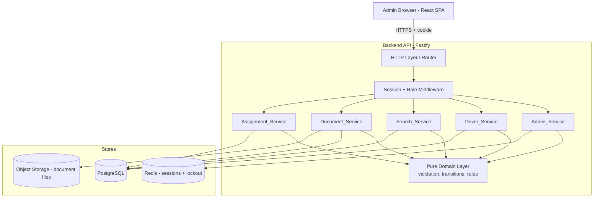
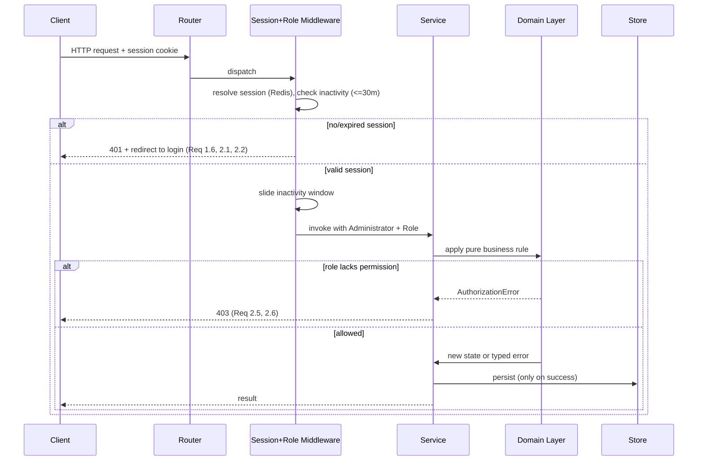
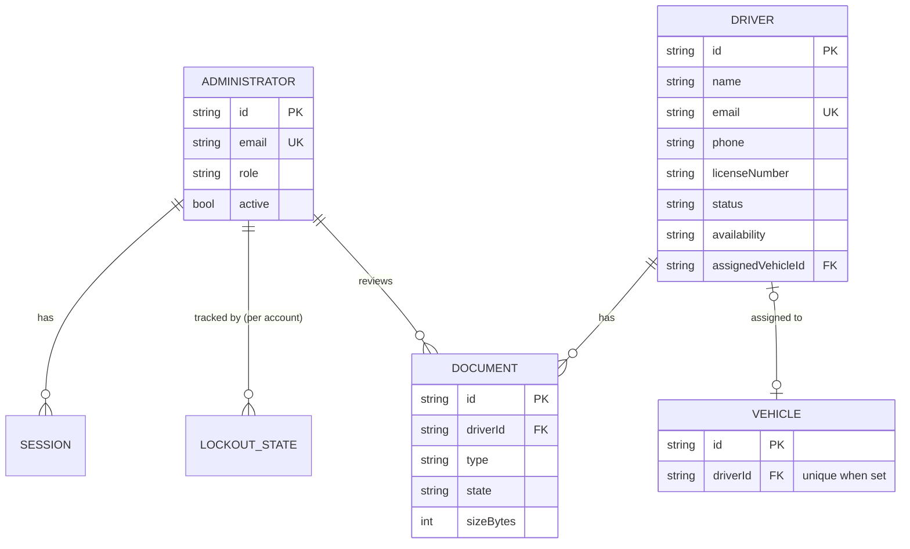

# Design Document

## Overview

The Driver Management Dashboard is an administrative web application for managing the driver lifecycle within a fleet or ride-service organization. This design describes a single-page web frontend backed by a modular REST API. The backend is decomposed into five logical service components that map directly to the requirements: `Admin_Service` (authentication/authorization), `Driver_Service` (driver CRUD and state), `Search_Service` (search/filter), `Document_Service` (document upload and verification), and `Assignment_Service` (driver-vehicle linking).

The design emphasizes a clear separation between a thin HTTP/transport layer and a pure domain layer. All business rules — credential validation, status transitions, availability rules, assignment constraints, document validation, and search matching — live in pure functions in the domain layer so they can be exercised exhaustively with property-based tests, independent of the database or HTTP framework.

### Technology Stack and Rationale

The workspace has no existing code, so the stack is proposed to balance developer velocity, testability, and a strong property-based testing story.

| Concern | Choice | Rationale |
| --- | --- | --- |
| Language (backend + frontend) | TypeScript (Node.js 20+) | One language across the stack; strong typing makes domain invariants explicit and keeps property generators aligned with types. |
| Backend framework | Fastify | Lightweight, fast, first-class TypeScript support, schema-based request validation. |
| Frontend framework | React 18 + Vite | Mature SPA ecosystem; component model fits list/detail/forms; Vite gives fast builds. |
| Data store | PostgreSQL via Prisma ORM | Relational constraints (unique email, one-driver-per-vehicle) are enforced at the database level as a backstop to application rules. |
| Object storage | S3-compatible store (e.g., AWS S3 or MinIO) | Document files are stored as blobs; the database holds metadata and verification state. |
| Auth | Server-side sessions with HTTP-only, Secure cookies; sessions stored in Redis with TTL | TTL maps cleanly to the 30-minute inactivity expiry; Redis gives fast session reads and atomic lockout counters. |
| Property-based testing | fast-check | The standard PBT library for TypeScript; integrates with the chosen unit test runner. |
| Unit/integration test runner | Vitest | Fast, TypeScript-native, works with fast-check. |

Design decision: business logic is kept in **pure, side-effect-free functions** that take current state and an input and return either a new state or a typed error. Persistence, HTTP, file I/O, and clock access are injected at the edges. This is the key enabler for the correctness properties below.

## Architecture

### High-Level Architecture



### Request Flow

Every request to a protected route follows the same pipeline, which centralizes Requirements 1 and 2:



### Layering

- **Transport layer**: Fastify routes. Parses/validates request shape, maps domain results to HTTP status codes, serializes responses. No business rules.
- **Service layer**: One module per `*_Service`. Orchestrates: load current state from a repository, call the pure domain function, persist on success, emit audit records. Holds no business rules itself beyond sequencing.
- **Domain layer**: Pure functions and value types. All validation, state transitions, and constraint checks live here and are the target of property-based tests.
- **Repository layer**: Thin data-access adapters over Prisma, Redis, and object storage. Mockable in tests.

## Components and Interfaces

Each service is described by the pure domain functions it depends on (testable) and the orchestration it performs. Domain functions return a discriminated result: `{ ok: true, value }` or `{ ok: false, error }`.

### Admin_Service (Requirements 1, 2)

Pure domain functions:

- `validateCredentialFormat(email, password) -> Result<void, ValidationError>` — enforces email 1–254 chars, password 8–128 chars (Req 1.3).
- `evaluateLogin(account, submittedPassword, now, lockoutState) -> LoginDecision` — returns one of `Success`, `InvalidCredentials`, `AccountLocked` based on password match, active status, and lockout window (Req 1.1, 1.2, 1.4, 1.5).
- `nextLockoutState(current, outcome, now) -> LockoutState` — pure state machine over the failed-attempt counter and lockout window: increments on failure, resets to zero on success, opens a 15-minute lockout on the 5th consecutive failure within 15 minutes (Req 1.1, 1.2, 1.4).
- `isSessionExpired(session, now) -> boolean` — true when inactivity exceeds 30 minutes (Req 1.6, 2.2).
- `isActionAllowed(role, action) -> boolean` — Viewer may `read`; Manager may `read | create | update | status-change`; unknown/undefined roles may do nothing (Req 2.3, 2.4, 2.5, 2.6).

Orchestration:

- Login reads the account and lockout counter from Redis, applies `evaluateLogin` + `nextLockoutState`, writes the updated counter, and on success creates a session with a sliding 30-minute TTL. Error messages for invalid credentials are uniform and do not reveal whether email or password was wrong (Req 1.2).
- Logout deletes the session key (Req 1.7).
- The session+role middleware applies `isSessionExpired` and `isActionAllowed` on every protected request.

Interface (representative):

```
POST /api/auth/login        { email, password } -> 200 { administrator } | 400 | 401 | 423
POST /api/auth/logout       -> 204
GET  /api/auth/session      -> 200 { administrator } | 401
```

### Driver_Service (Requirements 3, 5, 6, 7, 8, 9)

Pure domain functions:

- `validateDriverInput(input) -> Result<ValidDriver, FieldErrors>` — name 1–100, email 1–254 and format `local-part@domain`, phone 7–15 digits (create) / 7–20 chars (edit), license 1–50 (Req 6.2, 6.4, 6.5, 7.1, 7.4). Returns per-field errors.
- `isDuplicateEmail(email, existing) -> boolean` — case-insensitive comparison, excluding the record being edited (Req 6.3, 7.2).
- `newDriverDefaults() -> { status: Inactive, availability: Unavailable }` (Req 6.1).
- `applyStatusChange(driver, target, now) -> Result<Driver, StatusError>` — validates target ∈ {Active, Inactive, Suspended}; Active requires at least one Verified license document; Inactive and Suspended force Availability to Unavailable (Req 8.1–8.5).
- `applyAvailabilityChange(driver, target, now) -> Result<Driver, AvailabilityError>` — target ∈ {Available, Unavailable}; Available only permitted when status is Active (Req 9.1–9.3).
- `paginate(records, pageSize=25, requestedPage) -> { page, pageItems, outOfRange }` — orders by name ascending, 25 per page, clamps out-of-range requests to page 1 with a flag (Req 3.2, 3.3, 3.4).
- `fillEmptyFields(driver) -> DriverView` — represents unset fields as explicit empty indicators rather than omitting them (Req 5.2).

Orchestration:

- Create/edit load existing records for duplicate-email checks, call validation, persist only on success, and leave records unchanged on any failure (Req 6, 7).
- Status/availability changes load the driver, apply the pure transition, persist on success, and record administrator id + timestamp for availability changes (Req 9.5).
- List and detail reads enforce the 3-second budget via indexed queries and return the fully-populated view (Req 3.1, 5.1).

Interface (representative):

```
GET   /api/drivers?page=                 -> 200 { items, page, totalPages, outOfRange }
GET   /api/drivers/:id                    -> 200 { driver } | 400 | 404
POST  /api/drivers                        -> 201 { driver } | 400 | 409 (duplicate email)
PUT   /api/drivers/:id                    -> 200 { driver } | 400 | 404 | 409
PATCH /api/drivers/:id/status             -> 200 { driver } | 400 | 404 | 409 (license required)
PATCH /api/drivers/:id/availability       -> 200 { driver } | 400 | 404 | 409
```

### Search_Service (Requirement 4)

Pure domain functions:

- `validateSearchTerm(term) -> Result<string, ValidationError>` — 1–100 chars (Req 4.2).
- `matchesCriteria(driver, criteria) -> boolean` — case-insensitive substring match of the term against name or identifier, exact match on status filter and availability filter, with all supplied criteria combined by logical AND (Req 4.1, 4.3, 4.4, 4.5).

Orchestration:

- Validates the term, then returns all drivers satisfying `matchesCriteria`. Empty results produce a "no matches" message; invalid terms preserve the current result set (Req 4.2, 4.6).

Interface:

```
GET /api/drivers/search?term=&status=&availability= -> 200 { items } | 400
```

### Document_Service (Requirement 10)

Pure domain functions:

- `validateUpload(fileSizeBytes, mimeType) -> Result<void, UploadError>` — rejects size > 10 MiB and formats other than PDF/JPEG/PNG (Req 10.5, 10.6).
- `applyVerify(document, adminId, now) -> Document` — sets state Verified from Pending or Rejected and records verifier id + timestamp (Req 10.2).
- `applyReject(document, reason, adminId, now) -> Result<Document, RejectError>` — requires reason 1–500 chars; on success sets state Rejected and stores reason, rejecter id, and timestamp; otherwise leaves state unchanged (Req 10.3, 10.4).

Orchestration:

- Upload validates first, then stores the blob in object storage and metadata (with state Pending and upload timestamp) in PostgreSQL; on validation failure no record and no blob are written (Req 10.1, 10.5, 10.6).

Interface:

```
POST  /api/drivers/:id/documents               (multipart) -> 201 { document } | 400 | 413
PATCH /api/documents/:docId/verify             -> 200 { document } | 404
PATCH /api/documents/:docId/reject             { reason } -> 200 { document } | 400 | 404
```

### Assignment_Service (Requirement 11)

Pure domain functions:

- `canAssign(driver, vehicle) -> Result<void, AssignmentError>` — permits assignment only when the driver status is Active, the vehicle has no current driver, and the driver has no current vehicle (Req 11.1–11.4).
- `canUnassign(driver) -> Result<void, AssignmentError>` — permits removal only when the driver currently has a vehicle link (Req 11.5, 11.6).

Orchestration:

- Assignment loads driver and vehicle state, applies `canAssign`, and persists the link transactionally; the database also carries a unique constraint on `vehicle.driverId` as a backstop against concurrent assignment (Req 11.3). Removal applies `canUnassign` and clears the link (Req 11.5).

Interface:

```
POST   /api/drivers/:id/assignment   { vehicleId } -> 200 { assignment } | 409
DELETE /api/drivers/:id/assignment                 -> 200 | 409 (no assignment)
```

## Data Models

### Domain Types

```typescript
type DriverStatus = "Active" | "Inactive" | "Suspended";
type Availability = "Available" | "Unavailable";
type VerificationState = "Pending" | "Verified" | "Rejected";
type DocumentType = "DrivingLicense" | "IdentityProof";
type Role = "Viewer" | "Manager";

interface Administrator {
  id: string;
  email: string;          // 1..254
  passwordHash: string;   // bcrypt/argon2; raw password never stored
  role: Role;
  active: boolean;
}

interface LockoutState {
  failedAttempts: number;      // 0..5
  windowStartedAt: string | null;  // ISO timestamp of first failure in window
  lockedUntil: string | null;      // ISO timestamp; set when 5th failure occurs
}

interface Session {
  id: string;
  administratorId: string;
  createdAt: string;
  lastActivityAt: string;      // used for 30-minute inactivity expiry
}

interface Driver {
  id: string;
  name: string;                // 1..100
  email: string;               // 1..254, format local-part@domain
  phone: string;               // digits 7..15 on create; 7..20 chars on edit
  licenseNumber: string;       // 1..50
  status: DriverStatus;
  availability: Availability;
  assignedVehicleId: string | null;
  documents: Document[];
  availabilityChangedBy: string | null;   // Req 9.5
  availabilityChangedAt: string | null;   // Req 9.5
}

interface Document {
  id: string;
  driverId: string;
  type: DocumentType;
  mimeType: "application/pdf" | "image/jpeg" | "image/png";
  sizeBytes: number;           // <= 10 * 1024 * 1024
  storageKey: string;          // object-storage pointer
  state: VerificationState;
  uploadedAt: string;
  reviewedBy: string | null;
  reviewedAt: string | null;
  rejectionReason: string | null;  // 1..500 when state === Rejected
}

interface Vehicle {
  id: string;
  driverId: string | null;     // unique when non-null -> one driver per vehicle
}
```

### Entity Relationships



### Key Persistence Constraints

- `administrator.email` and `driver.email` are stored with a case-insensitive unique index, backing the duplicate-email rules (Req 6.3, 7.2) at the database level.
- `vehicle.driverId` carries a unique constraint so a vehicle links to at most one driver (Req 11.3), and the driver's `assignedVehicleId` is set in the same transaction so a driver holds at most one vehicle (Req 11.4).
- Driver list queries use an index on `name` to support ordered, paginated reads (Req 3.2).


## Correctness Properties

*A property is a characteristic or behavior that should hold true across all valid executions of a system — essentially, a formal statement about what the system should do. Properties serve as the bridge between human-readable specifications and machine-verifiable correctness guarantees.*

These properties target the pure domain layer. Each is implemented by a single property-based test running a minimum of 100 iterations.

### Property 1: Successful login resets the failed-attempt counter

*For any* lockout state, applying `nextLockoutState` with a `Success` outcome yields a state whose `failedAttempts` is 0 and whose `lockedUntil` is null.

**Validates: Requirements 1.1**

### Property 2: Each invalid-credential attempt increments the counter by exactly one

*For any* lockout state below the lockout threshold, applying `nextLockoutState` with an `InvalidCredentials` outcome increases `failedAttempts` by exactly one.

**Validates: Requirements 1.2**

### Property 3: Invalid-credential errors are indistinguishable

*For any* pair of failing login inputs — one with a wrong email, one with a wrong password — the returned authentication error message is identical, revealing nothing about which field was incorrect.

**Validates: Requirements 1.2**

### Property 4: Credential-format rejection leaves the counter untouched

*For any* email outside 1–254 characters or password outside 8–128 characters, `validateCredentialFormat` rejects the input and the failed-attempt counter is unchanged.

**Validates: Requirements 1.3**

### Property 5: Five failures within the window open a 15-minute lockout

*For any* sequence of five consecutive `InvalidCredentials` outcomes whose timestamps span at most 15 minutes, the resulting state has `lockedUntil` equal to the fifth failure's timestamp plus 15 minutes.

**Validates: Requirements 1.4**

### Property 6: An active lockout rejects every login

*For any* account whose `lockedUntil` is in the future, `evaluateLogin` returns `AccountLocked` regardless of whether the submitted password is correct.

**Validates: Requirements 1.5**

### Property 7: Session expiry tracks the 30-minute inactivity boundary

*For any* session and current time, `isSessionExpired` is true if and only if the elapsed time since `lastActivityAt` exceeds 30 minutes.

**Validates: Requirements 1.6, 2.2**

### Property 8: Role permissions are exactly defined

*For any* role and action, `isActionAllowed` returns true only in these cases: a Viewer with the `read` action, or a Manager with any action in {read, create, update, status-change}. Every other role value (including undefined or unrecognized roles) and every other combination returns false.

**Validates: Requirements 2.3, 2.4, 2.6**

### Property 9: Denied mutations leave records unchanged

*For any* driver record and any mutating action (create, update, status-change) requested by an administrator whose role lacks permission, the service returns an authorization error and the stored record is byte-for-byte identical to the original.

**Validates: Requirements 2.5**

### Property 10: Pagination preserves, orders, and bounds all records

*For any* list of driver records, `paginate` produces pages where every page holds at most 25 records, the concatenation of pages is the input ordered by name ascending, and the multiset of paginated records equals the input multiset (no record lost or duplicated).

**Validates: Requirements 3.2, 3.3**

### Property 11: Out-of-range page requests clamp to the first page

*For any* requested page number, `paginate` sets `outOfRange` true and returns the first page when the number is less than 1 or greater than the total number of pages, and sets `outOfRange` false otherwise.

**Validates: Requirements 3.4**

### Property 12: Search returns exactly the records matching every criterion

*For any* dataset and any combination of search term, status filter, and availability filter, the returned set contains exactly those records that case-insensitively contain the term in name or identifier AND exactly match every supplied filter — nothing more, nothing less.

**Validates: Requirements 4.1, 4.3, 4.4, 4.5**

### Property 13: Search-term length validation tracks the 1–100 boundary

*For any* search term, `validateSearchTerm` rejects it if and only if its length is less than 1 or greater than 100.

**Validates: Requirements 4.2**

### Property 14: Detail views expose every field with explicit empties

*For any* driver, the view produced by `fillEmptyFields` contains a key for every defined field of the Driver Record, and every field with no stored value carries an explicit empty indicator rather than being omitted.

**Validates: Requirements 5.2**

### Property 15: New drivers start Inactive and Unavailable

*For any* valid create input, the created Driver Record has Driver Status Inactive and Availability Unavailable.

**Validates: Requirements 6.1**

### Property 16: Missing required fields are reported exactly

*For any* create input in which a non-empty subset of {name, email, phone, license} is blank, `validateDriverInput` rejects the input and the set of reported missing fields equals exactly the set of blanked fields; no record is created.

**Validates: Requirements 6.2**

### Property 17: Duplicate emails are detected case-insensitively

*For any* set of existing drivers and any new email equal to a member's email under case-insensitive comparison, `isDuplicateEmail` returns true and the create is rejected with no record created.

**Validates: Requirements 6.3**

### Property 18: Email format validation accepts well-formed and rejects malformed addresses

*For any* string, email validation accepts it if and only if it matches the form `local-part@domain` with non-empty local and domain parts and a total length of at most 254 characters; otherwise it is rejected and no record is created.

**Validates: Requirements 6.4**

### Property 19: Phone and license boundaries are enforced per field

*For any* create input, the reported invalid-field set includes `phone` exactly when its digit count is outside 7–15 and includes `license` exactly when its length exceeds 50; no record is created when any field is invalid.

**Validates: Requirements 6.5**

### Property 20: Valid edits round-trip through storage

*For any* existing driver and any valid update to name (1–100), email (1–254, valid format), phone (7–20), and license (1–50), applying the update then reading the record back yields the submitted values.

**Validates: Requirements 7.1**

### Property 21: Editing to another record's email is rejected and leaves the record unchanged

*For any* two distinct driver records, setting one record's email to the other's email under case-insensitive comparison is rejected and the edited record is left unchanged.

**Validates: Requirements 7.2**

### Property 22: Invalid edit fields are rejected and leave the record unchanged

*For any* existing driver and any update in which at least one of name, email, phone, or license is empty or exceeds its length limit, the update is rejected, the failing field is named, and the stored record is unchanged.

**Validates: Requirements 7.4**

### Property 23: Activation succeeds exactly when a Verified license exists

*For any* driver, applying a status change to Active succeeds and sets Driver Status to Active if and only if the driver has at least one Verified driving-license Document; otherwise the change is rejected and the driver is left unchanged.

**Validates: Requirements 8.1, 8.4**

### Property 24: Inactive and Suspended force Unavailable

*For any* driver, applying a status change to Inactive or Suspended sets the Driver Status accordingly and sets Availability to Unavailable.

**Validates: Requirements 8.2, 8.3**

### Property 25: Invalid status values are rejected

*For any* target status value not in {Active, Inactive, Suspended}, the status change is rejected and the driver is left unchanged.

**Validates: Requirements 8.5**

### Property 26: Active drivers accept any valid availability value

*For any* driver with Driver Status Active and any availability value in {Available, Unavailable}, the change succeeds and the resulting Availability equals the requested value.

**Validates: Requirements 9.1**

### Property 27: Available is rejected for non-Active drivers

*For any* driver whose Driver Status is not Active, setting Availability to Available is rejected and the prior Availability value is retained.

**Validates: Requirements 9.2**

### Property 28: Invalid availability values are rejected

*For any* availability value not in {Available, Unavailable}, the change is rejected and the prior Availability value is retained.

**Validates: Requirements 9.3**

### Property 29: Successful availability changes record actor and timestamp

*For any* successful availability change, the resulting record stores the acting administrator identifier and the change timestamp supplied with the operation.

**Validates: Requirements 9.5**

### Property 30: Verifying a document records the reviewer and sets Verified

*For any* document in state Pending or Rejected, applying verify sets its Verification State to Verified and records the verifying administrator identifier and verification timestamp.

**Validates: Requirements 10.2**

### Property 31: Rejecting with a valid reason stores the rejection details

*For any* reason of length 1–500, applying reject sets the Verification State to Rejected and stores the reason, the rejecting administrator identifier, and the rejection timestamp.

**Validates: Requirements 10.3**

### Property 32: Rejecting without a valid reason leaves state unchanged

*For any* reason that is empty or exceeds 500 characters, the reject operation fails and the document's Verification State is unchanged.

**Validates: Requirements 10.4**

### Property 33: Upload size validation tracks the 10 MB boundary

*For any* file size, `validateUpload` rejects the upload if and only if the size exceeds 10 megabytes; a rejected upload stores no Document record.

**Validates: Requirements 10.5**

### Property 34: Upload format validation accepts only PDF, JPEG, and PNG

*For any* MIME type, `validateUpload` rejects the upload if and only if the type is not one of PDF, JPEG, or PNG; a rejected upload stores no Document record.

**Validates: Requirements 10.6**

### Property 35: Assignment forms a link only when all preconditions hold

*For any* driver and vehicle, `canAssign` succeeds — forming a link between exactly that driver and vehicle — if and only if the driver's status is Active, the driver has no current vehicle, and the vehicle has no current driver; in every other case the assignment is rejected and all existing links are left unchanged.

**Validates: Requirements 11.1, 11.2, 11.3, 11.4**

### Property 36: Assign then unassign returns to the unlinked state

*For any* Active, unassigned driver and unlinked vehicle, assigning the driver to the vehicle and then removing the assignment restores the original state in which neither the driver nor the vehicle holds a link.

**Validates: Requirements 11.1, 11.5**

### Property 37: Removing a non-existent assignment is rejected

*For any* driver with no current vehicle link, applying assignment removal is rejected with a no-assignment error and no state changes.

**Validates: Requirements 11.6**

## Error Handling

Errors are modeled as a typed, discriminated union in the domain layer and mapped to HTTP responses at the transport layer. The domain never throws for expected failures; it returns `{ ok: false, error }`.

| Domain error | Meaning | HTTP status | Requirements |
| --- | --- | --- | --- |
| `ValidationError` | Field format/length violation; carries per-field detail | 400 | 1.3, 4.2, 5.4, 6.2, 6.4, 6.5, 7.4, 8.5, 9.3, 10.4 |
| `AuthenticationError` | Invalid credentials (uniform message) | 401 | 1.2 |
| `AccountLockedError` | Account within a 15-minute lockout | 423 | 1.4, 1.5 |
| `SessionInvalidError` | Missing or inactivity-expired session | 401 (+ redirect to login) | 1.6, 2.1, 2.2 |
| `AuthorizationError` | Role lacks permission for the action | 403 | 2.5, 2.6 |
| `NotFoundError` | Driver or document identifier does not exist | 404 | 5.3, 7.3, 8.6, 9.4 |
| `DuplicateEmailError` | Email already used by another driver | 409 | 6.3, 7.2 |
| `StatusTransitionError` | Activation without a Verified license | 409 | 8.4 |
| `AvailabilityError` | Available set on a non-Active driver | 409 | 9.2 |
| `UploadRejectedError` | File too large or unsupported format | 413 (size) / 415 (format) | 10.5, 10.6 |
| `AssignmentConflictError` | Driver/vehicle already linked, or no link to remove | 409 | 11.2, 11.3, 11.4, 11.6 |
| `DependencyError` | A downstream store/service failed | 502/503 | 3.6 |

Error-handling principles:

- **No partial mutation.** Services persist only after the domain function returns success, so any rejected operation leaves stored state unchanged (Req 2.5, 6.2, 7.2, 7.4, 8.4, 9.2, 10.4, 11.2, 11.3, 11.4).
- **Uniform auth errors.** Invalid-credential responses never disclose which field was wrong (Req 1.2).
- **Graceful degradation on read failures.** When the driver list cannot be retrieved, the Dashboard surfaces an error and retains the previously displayed records (Req 3.6).
- **Explicit empty states.** Empty list, empty search result, and unset-field cases return explicit indicators rather than silent omissions (Req 3.5, 4.6, 5.2).

## Testing Strategy

The feature is a strong fit for property-based testing: the core logic (credential/lockout state machine, validation, status/availability transitions, search matching, pagination, document verification, and assignment constraints) is expressed as pure functions with clear input/output behavior and universal properties across large input spaces. The testing approach is therefore dual: property-based tests for universal behavior, and example/integration tests for specific scenarios, wiring, and latency budgets.

### Property-Based Tests

- Library: **fast-check**, run under **Vitest**. The design does not reimplement property testing from scratch.
- Each of the 37 correctness properties above is implemented by exactly one property-based test.
- Each property test runs a **minimum of 100 iterations**.
- Each property test is tagged with a comment of the form:
  `// Feature: driver-management-dashboard, Property {number}: {property_text}`
- Custom generators produce: administrators and roles (including out-of-set role strings for Property 8), lockout states and timestamp sequences, drivers with varied field subsets and document sets, boundary-length strings for name/email/phone/license/search-term/reason, file sizes around the 10 MB boundary, MIME types inside and outside the allow-list, and driver/vehicle linkage states.
- Generators deliberately exercise edge cases flagged in prework: empty and whitespace-only strings, case-permuted emails, identifiers that are empty or malformed, and timestamps straddling the 30-minute and 15-minute boundaries.

### Unit (Example) Tests

Example-based unit tests cover the specific scenarios classified as EXAMPLE/EDGE_CASE in prework, where behavior does not vary with input:

- Empty driver list shows the empty-state message (Req 3.5).
- Search criteria matching nothing shows the no-match message (Req 4.6).
- Lookup/edit/status/availability on an unknown identifier returns a not-found error (Req 5.3, 7.3, 8.6, 9.4).
- Empty or malformed identifier returns an invalid-identifier error (Req 5.4).
- Driver_Service read failure surfaces an error and retains prior records (Req 3.6).

### Integration Tests

Integration tests cover wiring, side effects, and latency budgets that fall outside pure logic:

- Login/logout and session lifecycle: logout invalidates the session; a request with no or an expired session is denied and redirected to login (Req 1.7, 2.1, 2.2).
- List and detail reads return the specified field shape and meet their latency budgets against seeded data (Req 3.1, 5.1).
- Document upload stores the file in object storage, links it to the driver, timestamps it, and sets state Pending within the budget (Req 10.1).
- End-to-end assignment and removal against the database, including the unique-vehicle constraint under concurrent assignment (Req 11.1, 11.3, 11.5).
- Latency-sensitive operations (login ≤ 2s, list/detail ≤ 3s, search ≤ 2s, status/availability ≤ 2s, upload ≤ 5s, assignment ≤ 3s) are asserted with representative data.

### Coverage Balance

Property tests carry the burden of input-space coverage, so unit tests stay focused on concrete examples and error scenarios rather than enumerating inputs. Integration tests are kept to a small number of representative cases per behavior, since repeated execution of external-service interactions adds little bug-finding value over the pure-logic property tests.
