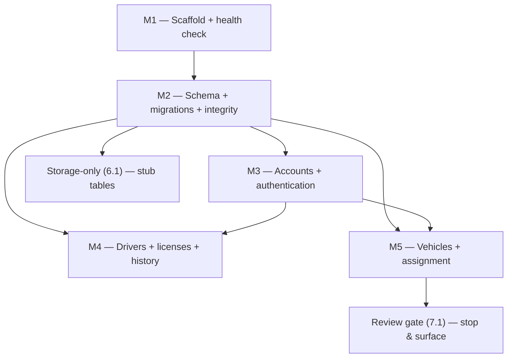

# Implementation Plan — Driver Management Platform MVP (M1–M5)

## Overview

Build the MVP in order (M1 → M5). Each slice is independently shippable and testable, so every later slice has a working baseline. Work stops after M5 for human review; the storage-only and review-gate tasks bound that scope. Every task's done-definition follows steering `tech.md` §Definition of "Done" (backend `pytest`/`ruff`, web `build`/`lint`, happy-path + auth + validation tests, a rejection test per added constraint, and no PII/secrets in logs or fixtures).

## Tasks

### M1 — Project scaffold + health check

- [ ] 1.1 Create `services/api` package: `pyproject.toml` (uv), `alembic.ini`, `alembic/versions/`, `app/main.py` app factory.
  - _Requirements: 1.2, 1.4, 6.1_
- [ ] 1.2 Add `app/core/config.py` reading `DATABASE_URL` from env (no hardcoded secrets); `app/core/db.py` async session.
  - _Requirements: 1.4, 6.4_
- [ ] 1.3 Implement `GET /health` returning `{"status":"ok"}` and register a single exception handler in `app/core/errors.py`.
  - _Requirements: 1.2, 6.3_
- [ ] 1.4 Add `infra/compose/docker-compose.yml` (or root `docker-compose.yml`) with PostgreSQL 16 on localhost:5432.
  - _Requirements: 1.1_
- [ ] 1.5 Add at least one passing test and wire `uv run pytest` + `ruff`.
  - _Requirements: 1.3, 6.6_

### M2 — Database schema + migrations + integrity

- [ ] 2.1 Translate all 17 tables from `docs/schema.dbml` into SQLAlchemy 2.x typed models under each domain's `models.py`.
  - _Requirements: 2.1_
- [ ] 2.2 Generate the initial Alembic migration creating every table, PK, unique constraint, and FK (`ON DELETE RESTRICT`).
  - _Requirements: 2.1, 2.6_
- [ ] 2.3 Add enum/CHECK constraints for every status/role/type column from the DBML notes.
  - _Requirements: 2.2_
- [ ] 2.4 Add the `accounts` driver/customer XOR + role-match CHECK.
  - _Requirements: 2.3_
- [ ] 2.5 Add `date_trunc('month', month) = month` CHECK on `income_policies.month` and `payroll_periods.month`.
  - _Requirements: 2.4_
- [ ] 2.6 Add `EXCLUDE` (btree_gist) constraints preventing overlapping intervals on `employment_history` and `driver_vehicles`.
  - _Requirements: 2.5_
- [ ] 2.7 Add soft-archive `archived_at` handling on `drivers`/`customers`; preserve the `payrolls.policy_id` ambiguity as-is with a `# NEEDS-OWNER:` note.
  - _Requirements: 2.6, 2.9_
- [ ] 2.8 Write a round-trip test (insert + read one account and one driver) and a rejection test per added constraint.
  - _Requirements: 2.7, 2.8, 6.6_

### M3 — Accounts + authentication

- [ ] 3.1 Implement `app/core/security.py`: argon2/bcrypt hashing, JWT encode/decode with role claim, current-account dependency, ADMIN role guard.
  - _Requirements: 3.1, 3.4, 6.5_
- [ ] 3.2 Implement `POST /auth/login` (generic failure message) and `GET /auth/me` (never returns `password_hash`).
  - _Requirements: 3.1, 3.2, 3.3_
- [ ] 3.3 Implement `accounts` domain CRUD restricted to ADMIN, enforcing the account/role/link CHECK.
  - _Requirements: 3.5, 3.6, 3.7_
- [ ] 3.4 Tests: login success/failure, 403 for non-ADMIN account management, hash never returned/logged.
  - _Requirements: 3.2, 3.4, 3.6, 6.6_

### M4 — Drivers + licenses + employment history

- [ ] 4.1 Implement `areas` catalog CRUD (to support the driver area filter).
  - _Requirements: 4.3_
- [ ] 4.2 Implement `drivers` CRUD with pagination and `area_id` + status filtering; soft-archive via `archived_at`.
  - _Requirements: 4.1, 4.2, 4.8_
- [ ] 4.3 Implement `driver_licenses` management with unique `license_number`.
  - _Requirements: 4.4_
- [ ] 4.4 Implement status-change endpoint writing an `employment_history` row (`changed_by`, reason, interval) and rejecting overlaps.
  - _Requirements: 4.5, 4.6, 6.5_
- [ ] 4.5 Ensure PII fields are never logged; add tests for CRUD, license uniqueness, history write, overlap rejection, and no-PII-in-logs.
  - _Requirements: 4.7, 6.6_

### M5 — Vehicles + driver–vehicle assignment

- [ ] 5.1 Implement `vehicles` CRUD with unique `plate_number` and `vehicle_type` CHECK.
  - _Requirements: 5.1_
- [ ] 5.2 Implement assignment creating a `driver_vehicles` interval; re-assignment closes the prior active interval.
  - _Requirements: 5.2, 5.3_
- [ ] 5.3 Reject overlapping active assignments (per driver and per vehicle); add tests for assign, re-assign-closes-prior, and overlap rejection.
  - _Requirements: 5.4, 6.6_

### Storage-only (stub, do not implement rules)

- [ ] 6.1 Add models + migration coverage for `customers`, `bookings`, `leave_requests`, `leave_actions`, `work_schedule`, `activity_sessions`, `income_policies`, `payroll_periods`, `payrolls`, `payroll_adjustments`; stub service lifecycle methods with `NotImplementedError` + `# NEEDS-OWNER:` comments.
  - _Requirements: Non-Goals; 2.1_

### Review gate

- [ ] 7.1 Stop after M5. Confirm all `[ASSUMPTION]` comments are present and surface open `[NEEDS-OWNER]` decisions (payroll policy_id, PII masking/retention, FK/archive policy, lifecycle rules) for human review.
  - _Requirements: 2.9, 6.6_

## Task Dependency Graph



```json
{
  "waves": [
    { "id": 0, "tasks": ["1.1"] },
    { "id": 1, "tasks": ["1.2", "1.3", "1.4", "1.5"] },
    { "id": 2, "tasks": ["2.1"] },
    { "id": 3, "tasks": ["2.2", "2.3", "2.4", "2.5", "2.6", "2.7"] },
    { "id": 4, "tasks": ["2.8", "3.1", "6.1"] },
    { "id": 5, "tasks": ["3.2", "3.3"] },
    { "id": 6, "tasks": ["3.4", "4.1", "4.2", "5.1"] },
    { "id": 7, "tasks": ["4.3", "4.4", "5.2"] },
    { "id": 8, "tasks": ["4.5", "5.3"] },
    { "id": 9, "tasks": ["7.1"] }
  ]
}
```

## Notes

- Work stops after M5 at the review gate (7.1); M6+ depends on `[NEEDS-OWNER]` business rules and is out of MVP scope.
- `[NEEDS-OWNER]` domains (bookings, leave, scheduling/timekeeping, payroll) are storage-only: create models + migrations, stub lifecycle with `NotImplementedError` and a `# NEEDS-OWNER:` comment — do not invent rules.
- Every `[ASSUMPTION]` relied on (DB URL, JWT/hashing, overlap policy, FK/archive policy) must carry a `# ASSUMPTION:` code comment at the point of use so a human can confirm it.
- Each task references specific requirements for traceability; checkpoints are enforced by the per-task done-definition in the Overview.
